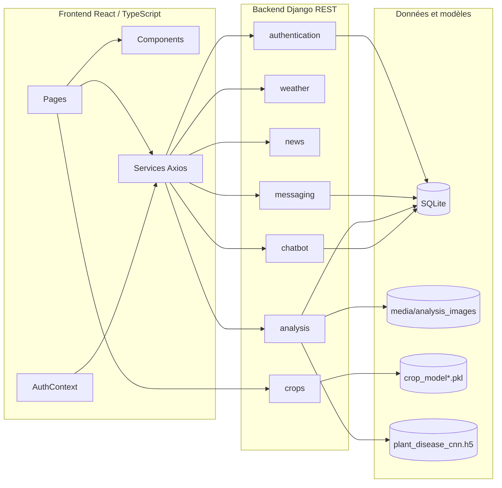
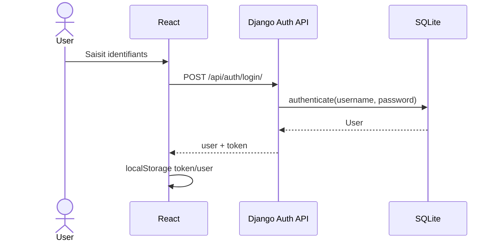
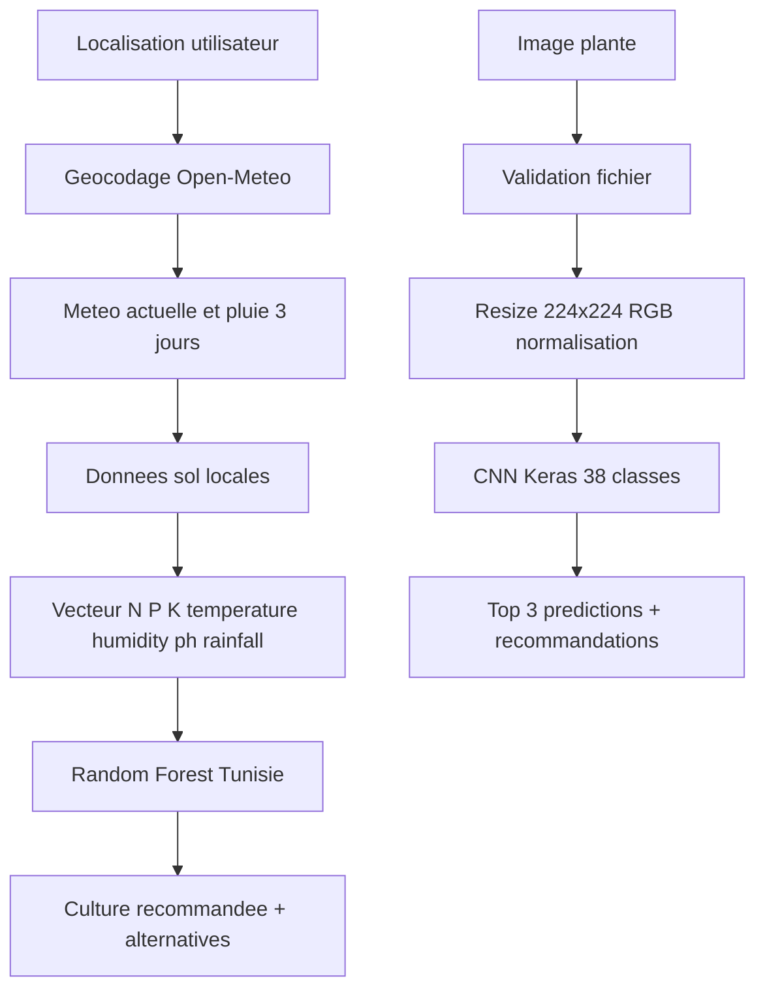

# Architecture Smart Firma

## Vue générale



## Backend

Le backend est un projet Django nommé `smartfirma`. Il expose une API JSON modulaire.

### Applications Django

| Application | Rôle |
|---|---|
| `authentication` | Utilisateur personnalisé, inscription, connexion, profil, liste admin |
| `messaging` | Messages reçus/envoyés, détail, suppression, compteur non lus |
| `weather` | Météo actuelle et prévisions via Open-Meteo/OpenWeatherMap |
| `news` | Actualités via NewsAPI |
| `analysis` | Upload image, CNN, historique d'analyse |
| `chatbot` | Chat OpenAI spécialisé agriculture tunisienne |
| `crops` | Recommandation culture par Random Forest |

## Frontend

Le frontend est une application React avec :

- `pages` : vues routées.
- `components` : composants partagés.
- `services` : appels API.
- `contexts` : gestion globale d'authentification.
- `styles` : CSS par domaine.

## Flux d'authentification



## Architecture ML



## DevOps

Aucun fichier Docker, pipeline CI/CD, Kubernetes ou monitoring n'a été détecté. L'exécution actuelle est locale :

```bash
cd backend
python manage.py runserver

cd frontend
npm start
```

