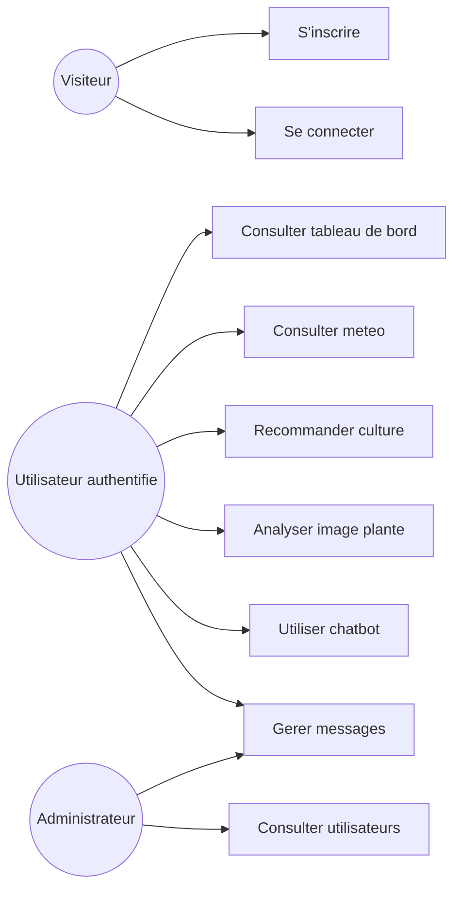
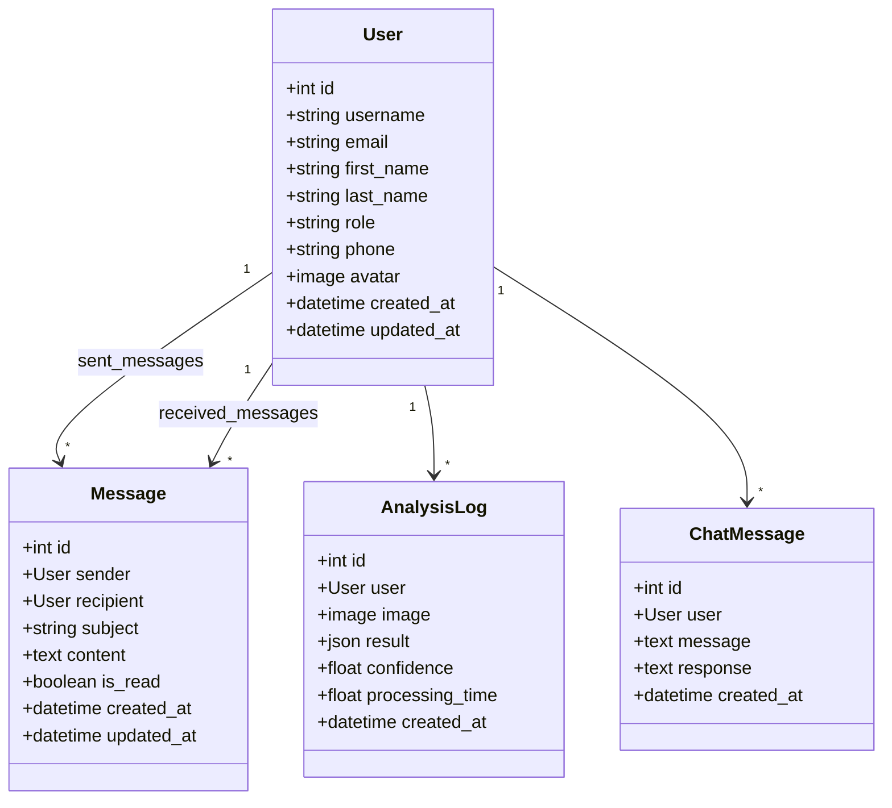
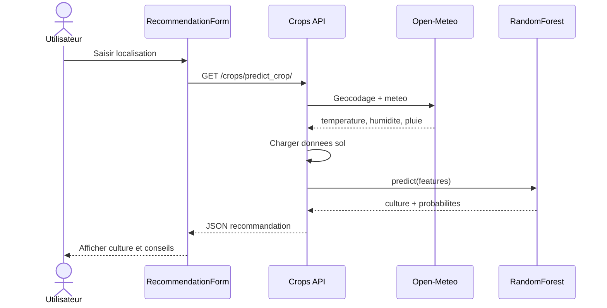
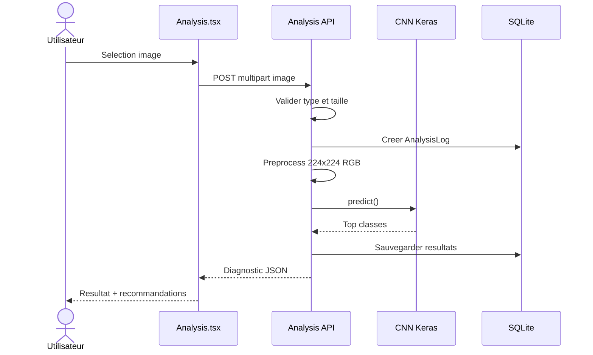
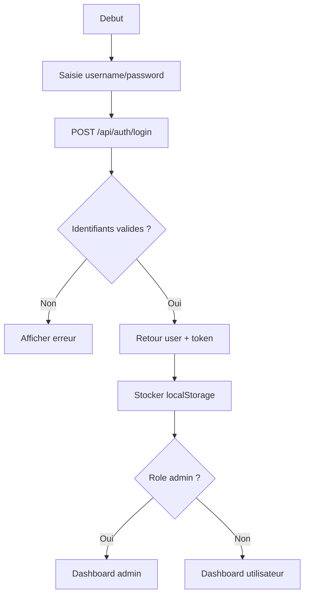
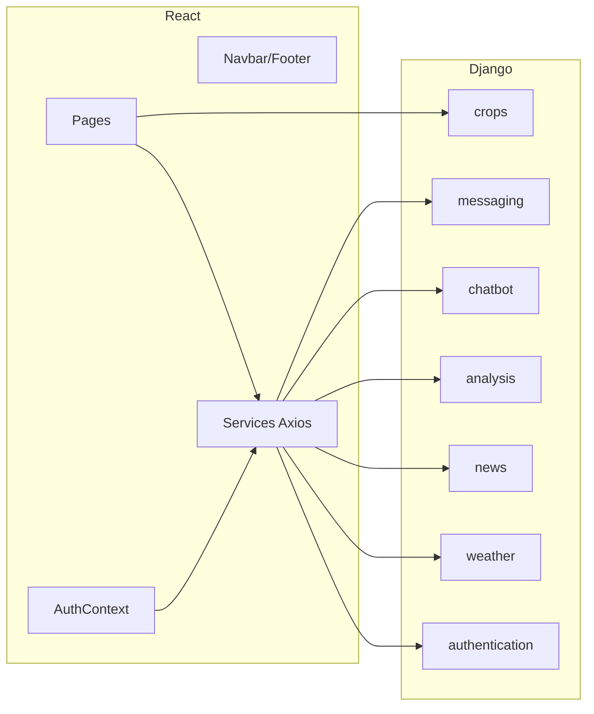

# UML Design Smart Firma

## Cas d'utilisation global

## Diagramme de classes

## Séquence : recommandation de culture

## Séquence : analyse de maladie

## Activité : authentification

## Composants

